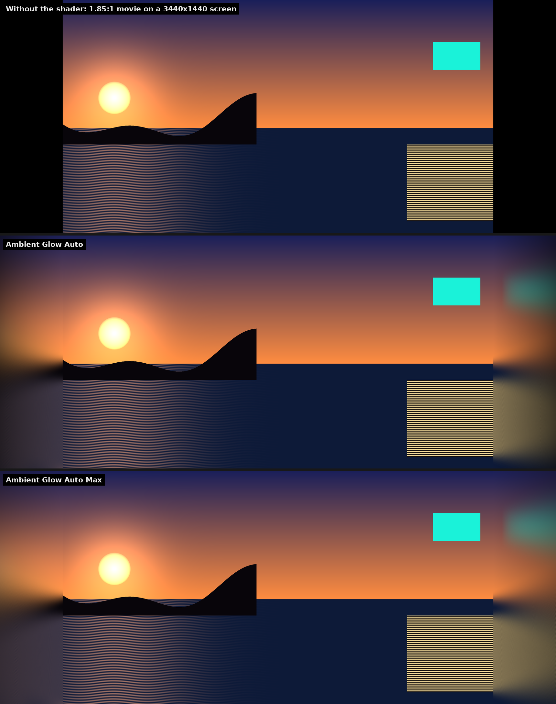

# Ambient Glow for PotPlayer

A YouTube-style "ambient mode" for [PotPlayer](https://potplayer.daum.net/). It fills the black bars beside a movie with a soft, blurred glow that takes its colour from the edges of the picture. It was made for watching 16:9 and 1.85:1 movies on a 21:9 ultrawide monitor.



*Synthetic test scene, rendered by the actual shader at 3440×1440.*

## Which file to use

| File | Use it for |
|---|---|
| **Ambient Glow Auto** | Recommended. It finds where the picture starts on every frame, so it works with 16:9, 1.85:1, 2:1 and 4:3 videos. The glow dims towards the screen edge. |
| **Ambient Glow Auto Max** | The same, but the glow fills almost all of the bars. |
| **Ambient Glow 16-9** | A strict version for exact 16:9 videos. It stays off for any other shape. |
| **Ambient Glow Stretch 16-9** | A fallback for renderers that don't give the black bars to shaders. Set PotPlayer to stretch the video to fill the screen, and this shader restores the 16:9 shape and fills the sides. |

Tick only one at a time. PotPlayer runs every ticked post-resize shader in sequence.

## Install

1. Download **Ambient-Glow-for-PotPlayer.zip** from the [latest release](https://github.com/Kyp935/potplayer-ambient-glow/releases/latest) and unzip it.
2. Copy the four `.txt` files into `C:\Program Files\DAUM\PotPlayer\PxShader`. Windows asks for admin permission.
3. In PotPlayer, right-click the video → **Video → Pixel Shaders → Reload Pixel Shader list**.
4. Right-click → **Video → Pixel Shaders → Post-Resize Pixel Shaders** → tick **Ambient Glow Auto**.
5. In the same Pixel Shaders menu, make sure **Use Post-Resize Pixel Shaders** is ticked and **Apply only to video image (ignores spaces)** is *not* ticked. The shader needs the black bars.
6. Play fullscreen.

## Requirements

- PotPlayer's **Built-in Direct3D 11 Video Renderer** (Preferences → Video → Video Renderer).
- Tested with PotPlayer 1.7.23122 (260819) on Windows 10 with an RTX 4060 and a 3440×1440 monitor.
- **Direct3D 9 renderer (untested):** set `RENDERER_D3D9` to `1` and add `// $MinimumShaderProfile=ps_3_0` as the first line of the file. This line isn't included by default because the Direct3D 11 renderer refuses to load any shader that contains it (see the notes below).

## Settings

Each file has a settings block at the top. To change a setting:
1. Edit the number. Notepad must be run as administrator, because the file is in Program Files.
2. Save the file.
3. In PotPlayer, choose **Reload Pixel Shader list**, then untick and re-tick the shader. Reloading alone doesn't recompile the active shader.

| Setting | Auto | Auto Max | What it does |
|---|---|---|---|
| `GLOW_STRENGTH` | 1.00 | 1.00 | Brightness right next to the picture (0–1). |
| `GLOW_FALLOFF` | 0.60 | 0.50 | How quickly the glow fades towards the screen edge. Higher = fades sooner. |
| `GLOW_REACH` | 1.40 | 2.00 | 1 = fades to black at the screen edge. Higher keeps more glow out to the edge. |
| `GLOW_SATURATION` | 1.00 | 1.00 | 1 = same colour intensity as the picture's edge. Higher = more vivid. |
| `GLOW_SOFTNESS` | 0.14 | 0.16 | Vertical blur at the outer edge, as a share of screen height. |
| `GLOW_EDGE_SOURCE` | 0.015 | 0.015 | Next to the picture, colour comes from this thin strip of its edge (share of picture width). |
| `GLOW_SOURCE` | 0.12 | 0.12 | At the screen edge, colour comes from this wider strip, for a softer spread. |
| `BLACK_LEVEL` | 0.004 | 0.004 | Pixels darker than this count as empty bar. |

## Compatibility

- **RTX Video Super Resolution** keeps working with the shader on. PotPlayer reports "GPU Super Resolution" as the resizer. As usual, Super Resolution only runs when the video is being upscaled, so not for 4K sources.
- **HDR passthrough** ("Use H/W HDR output mode") works with the shader on.
- Films that already fill the screen (2.39:1 on 21:9), credits on black, and the picture itself are left untouched. Only side bars that are completely black get lit.
- Auto mode: in very dark scenes, where the picture's own edge is black, the glow can occasionally extend into that black area. The 16-9 file never does this.

## How it works

The shader runs after resizing, over the whole screen including the bars:

1. **Find the picture.** The 16-9 file calculates the bar width from the screen size. The Auto files binary-search for the first column that isn't black. Both then check that the bars on both sides are completely empty; otherwise the shader does nothing.
2. **Colour each bar pixel.** It averages 96 samples from a strip at the picture's edge, at the same height. The strip is thin next to the picture, so the colour matches the edge exactly. It widens further out, together with a vertical blur, so the glow spreads like real light.
3. **Fade.** The glow fades towards the screen edge, with a tiny dither to prevent banding.

## Notes for shader authors: PotPlayer's Direct3D 11 renderer

These were found by testing on PotPlayer 1.7.23122 and checked against the strings in `PotPlayer64.dll`.

- PotPlayer converts DX9-style shaders for Direct3D 11 by find-and-replace. It renames `sampler` to `SamplerState`, declares the video as `Texture2D Texture0`, and provides a `tex2D` wrapper only. So `tex2Dlod` doesn't exist there; use `Texture0.SampleLevel(s0, uv, 0)` instead.
- If a shader file contains the text `ps_3_0` **anywhere, even in a comment**, PotPlayer compiles it for the DX9 shader model, and the Direct3D 11 renderer silently fails to load it. This is why PotPlayer's own *Adaptive sharpen* doesn't load on Direct3D 11.
- A rejected shader gives no error. PotPlayer simply keeps whatever shader was active before.
- After editing a shader file, use **Reload Pixel Shader list** and also untick/re-tick the shader.

## Building from source

The four files in `PxShader` are generated from [`src/ambient_glow_template.hlsl`](src/ambient_glow_template.hlsl) by [`src/build.py`](src/build.py):

```
python src/build.py
```

## License

[MIT](LICENSE)
